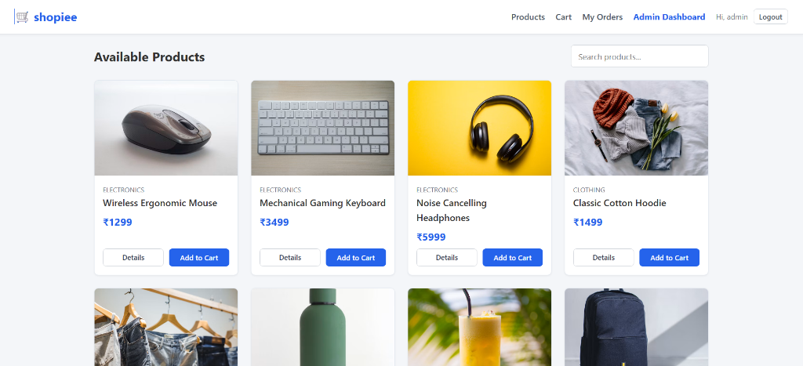
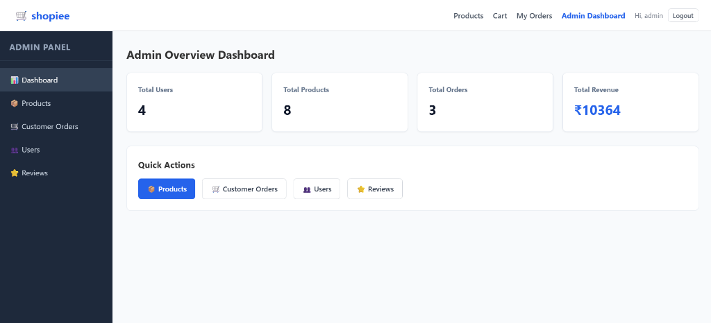
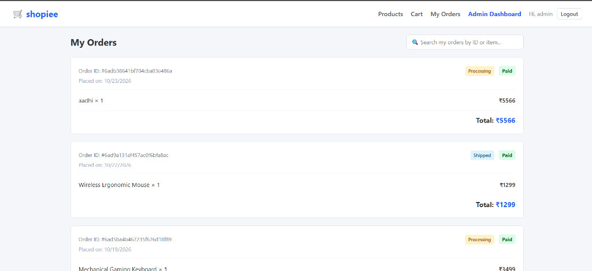
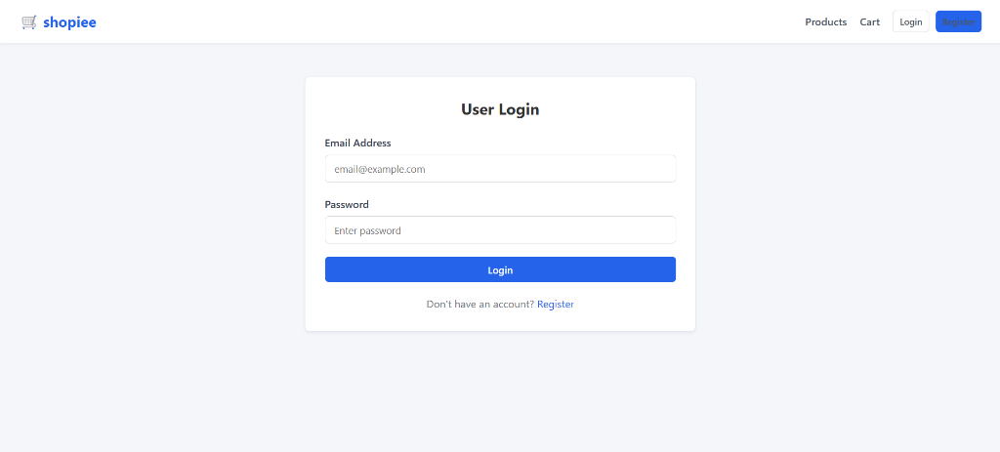
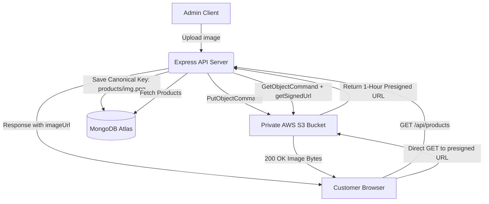
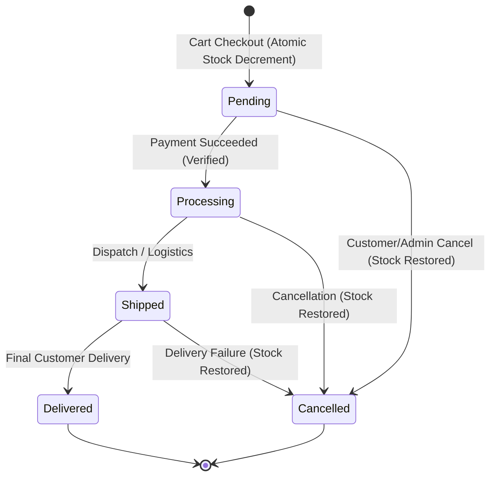

<div align="center">

# 🛒 Shopiee - Full-Stack E-Commerce Platform

A production-ready, highly secure Full-Stack E-Commerce web application built with the **MERN Stack** (MongoDB, Express.js, React 19, Node.js), powered by **Real-Time WebSockets (Socket.io)** and **Private AWS S3 Cloud Storage with Presigned URLs**.

[](https://react.dev/)
[](https://vitejs.dev/)
[](https://nodejs.org/)
[](https://expressjs.com/)
[](https://www.mongodb.com/)
[](https://aws.amazon.com/s3/)
[](https://socket.io/)
[](LICENSE)

</div>

---

## 📸 Application Screenshots

<div align="center">

### 🛍️ Storefront & Product Catalog
*Interactive product grid with instant search, category filtering, responsive cards, and stock status.*
<br/>


<br/><br/>

### 📊 Admin Overview & Analytics Dashboard
*Real-time business performance analytics tracking Total Users, Products, Orders, and strictly Verified Revenue.*
<br/>


<br/><br/>

### 📦 Customer Order Management & Tracking
*Real-time order tracking with status badges (Pending, Processing, Shipped, Delivered) and payment verification.*
<br/>


<br/><br/>

### 🔐 Secure User Authentication Portal
*Clean authentication interface with rate-limiting protection, token authorization, and role enforcement.*
<br/>


</div>

---

## 🌟 Key Features

### 🛍️ Storefront & Catalog Experience
- **Debounced Instant Search**: Sub-300ms product search with sanitized regex patterns to eliminate ReDoS vulnerabilities.
- **Product Specifications & Ratings**: Verified customer reviews, dynamic star calculations, and manufacturer warranty details.
- **Cart State Management**: Local client state synchronized with live server stock checks.

### 🛡️ Enterprise-Grade Security
- **Private S3 Storage (Zero Public Access)**: AWS S3 bucket maintains strict "Block All Public Access". Image retrieval uses short-lived **AWS SDK v3 Presigned GET URLs** (HMAC-SHA256 signatures with 1-hour expiration).
- **In-Database Price Enforcement**: Request body prices are completely ignored; order totals are authoritatively calculated directly from MongoDB, blocking client-side price manipulation.
- **Atomic Stock Decrement**: Uses MongoDB atomic operator `{ $inc: { stock: -qty } }` with condition `{ stock: { $gte: qty } }` to prevent race conditions and double-selling.
- **Privilege Escalation Protection**: User registration strictly forces `role: "user"`. Admin accounts cannot be created through public endpoints.
- **Brute-Force Rate Limiting**: Authentication endpoints are guarded by `express-rate-limit` (20 attempts per 15 minutes per IP).
- **Dynamic CORS Policy**: Regex-validated origin checks allowing secure communication across Vercel production and preview deployments (`*.vercel.app`).

### ⚡ Real-Time WebSockets (Socket.io)
- **Room-Scoped Messaging**: Clients are partitioned into scoped rooms (`admins`, `user_<id>`, `order_<id>`).
- **Instant Status Broadcasting**: Changing an order status immediately triggers real-time UI updates on both the customer's order tracker and the admin table without page reloads.

### 📋 Strict Order Finite State Machine (FSM)
- Enforces valid transition paths:  
  `Pending` ➔ `Processing` ➔ `Shipped` ➔ `Delivered` (or `Cancelled`).
- Fulfillments cannot bypass payment requirements (`paymentStatus === "Paid"`).
- Automated inventory restoral compensation upon order cancellation.

---

## 🏗️ System Architecture & Data Flow

### 1. Private Image Retrieval via S3 Presigning



### 2. Order Processing & Inventory State Machine



---

## 🛠️ Technology Stack

| Layer | Technologies |
| :--- | :--- |
| **Frontend** | React 19, Vite, React Router DOM v7, Socket.io Client, Context API |
| **Backend** | Node.js, Express 5, Socket.io, Multer, Express Rate Limit |
| **Database** | MongoDB Atlas, Mongoose ORM |
| **Cloud Storage** | AWS S3 (`@aws-sdk/client-s3`, `@aws-sdk/s3-request-presigner`) |
| **Security & Auth** | JSON Web Tokens (`jsonwebtoken`), `bcryptjs`, Node Crypto |
| **Deployment** | Vercel (Frontend SPA), Render (Backend Web Service) |

---

## 📁 Project Structure

```
UserManagement/my-react-app/
├── backend/
│   ├── config/
│   │   └── s3.js             # AWS S3 Client & Bucket Connection Check
│   ├── controllers/
│   │   ├── authController.js    # Register, Login, Password Reset
│   │   ├── orderController.js   # Order CRUD, FSM Lifecycle & Analytics
│   │   ├── paymentController.js # Payment processing & Status tracking
│   │   └── productController.js # Product CRUD, S3 Presigning & Reviews
│   ├── middleware/
│   │   ├── authMiddleware.js    # JWT Bearer Token validation
│   │   ├── roleMiddleware.js    # Role-Based Access Control (Admin)
│   │   └── uploadMiddleware.js  # Multer image filter & size limits
│   ├── models/
│   │   ├── Order.js             # Order Schema
│   │   ├── Product.js           # Product Catalog & Embedded Reviews
│   │   └── User.js              # User Schema
│   ├── routes/                  # Express Router Modules
│   ├── tests/
│   │   └── s3-image.test.js     # S3 URL Signing & Compatibility Unit Tests
│   ├── .env.example             # Environment template
│   └── server.js                # Express Server, Socket.io & MongoDB Init
│
├── frontend/
│   ├── src/
│   │   ├── components/          # Navbar, AdminSidebar, Modals
│   │   ├── context/             # CartContext
│   │   ├── pages/
│   │   │   ├── admin/           # Admin Dashboard, Products, Orders, Reviews
│   │   │   ├── cart.jsx         # Cart & Checkout
│   │   │   ├── Login.jsx        # Login Screen
│   │   │   ├── Orders.jsx       # Order Tracking
│   │   │   ├── ProductDetail.jsx# Product Details & Reviews
│   │   │   ├── Products.jsx     # Storefront Catalog
│   │   │   └── Signup.jsx       # Registration Screen
│   │   ├── App.jsx              # Routing Configuration
│   │   └── main.jsx             # React Application Entry
│   ├── package.json
│   └── vite.config.js
│
├── docs/
│   └── screenshots/             # Application UI Documentation Images
└── README.md                    # Project Documentation
```

---

## 🚀 Getting Started

### Prerequisites
- **Node.js** (v18.x or higher)
- **MongoDB** (Local instance or MongoDB Atlas cluster URI)
- **AWS Account** with S3 Bucket configured (Private, Block All Public Access enabled)

---

### 1️⃣ Clone the Repository
```bash
git clone https://github.com/Aadhitiya007/UserManagement.git
cd UserManagement/my-react-app
```

---

### 2️⃣ Backend Configuration & Startup

1. **Navigate to the backend directory:**
   ```bash
   cd backend
   ```

2. **Install dependencies:**
   ```bash
   npm install
   ```

3. **Configure Environment Variables:**
   Create a `.env` file in the `backend/` folder:
   ```env
   PORT=5000
   MONGO_URL=your_mongodb_connection_string
   JWT_SECRET=your_super_secret_jwt_key
   ADMIN_EMAIL=admin@example.com
   ADMIN_PASSWORD=admin123

   # AWS S3 Configuration (Private Bucket)
   AWS_REGION=ap-south-2
   AWS_S3_BUCKET_NAME=your-s3-bucket-name
   AWS_ACCESS_KEY_ID=your_aws_access_key
   AWS_SECRET_ACCESS_KEY=your_aws_secret_key

   # CORS Configuration
   CLIENT_URL=http://localhost:5173
   ```

4. **Run Unit & Presigning Tests:**
   ```bash
   npm test
   ```

5. **Start the backend development server:**
   ```bash
   npm run dev
   ```
   *Terminal Output:*
   ```text
   MongoDB connected successfully
   AWS S3 connected successfully (Bucket: your-s3-bucket-name)
   Server running on http://localhost:5000
   ```

---

### 3️⃣ Frontend Configuration & Startup

1. **Open a new terminal and navigate to the frontend directory:**
   ```bash
   cd frontend
   ```

2. **Install dependencies:**
   ```bash
   npm install
   ```

3. **Configure Environment Variables:**
   Create a `.env` file in the `frontend/` folder:
   ```env
   VITE_API_URL=http://localhost:5000
   ```

4. **Start the Vite development server:**
   ```bash
   npm run dev
   ```
   *Open your browser and navigate to `http://localhost:5173`.*

---

## 📡 API Reference Overview

| Method | Endpoint | Description | Access |
| :--- | :--- | :--- | :--- |
| **POST** | `/api/auth/register` | Register new customer account | Public |
| **POST** | `/api/auth/login` | Authenticate user & issue JWT token | Public |
| **POST** | `/api/auth/forgot-password` | Request password reset token | Public (Rate-Limited) |
| **POST** | `/api/auth/reset-password/:token`| Reset password using secure token | Public |
| **GET** | `/api/products` | Retrieve catalog with signed S3 URLs | Public |
| **GET** | `/api/products/:id` | Retrieve single product details & reviews | Public |
| **POST** | `/api/products` | Create product with image upload | 🔒 Admin |
| **PUT** | `/api/products/:id` | Update product details or image | 🔒 Admin |
| **DELETE**| `/api/products/:id` | Delete product & purge S3 object | 🔒 Admin |
| **POST** | `/api/orders` | Place order with atomic stock decrement | 🔒 Customer |
| **GET** | `/api/orders` | Fetch customer orders (Admin: all orders) | 🔒 Authenticated |
| **PUT** | `/api/orders/:id` | Update order fulfillment status (FSM) | 🔒 Admin |
| **GET** | `/api/orders/stats/overview`| Fetch system statistics & total revenue | 🔒 Admin |

---

## 📜 License

This project is licensed under the **MIT License**. Feel free to use, modify, and distribute this software in your own projects.
